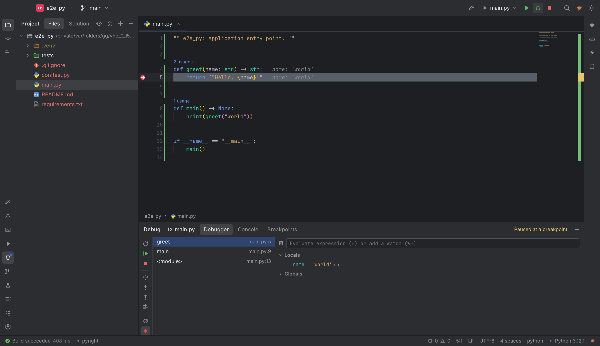

# Kiln IDE

A fast, Rider-style desktop IDE for **C#/.NET**, **Python** and **agentic-AI** projects, with Git, a debugger and
Claude built in. Built on Electron, Monaco, xterm.js and the Claude Agent SDK.



## Features

**Projects and builds**
- Detects .NET solutions/projects, Python roots (pyproject, requirements, Pipfile, conda), Node packages and
  agent frameworks (Claude Agent SDK, LangGraph, CrewAI, ADK, MCP servers) when a folder opens.
- Builds automatically on load: `dotnet build` with MSBuild error parsing, Python virtualenv creation (uv or
  venv), dependency install (skipped when nothing changed), syntax/import checks, pyflakes and `pip check`,
  Node install/TypeScript builds and agent configuration checks (missing API keys, MCP/LangGraph configs).
- New Solution wizard: Python app / FastAPI / Claude agent (in a `.venv`), .NET console / class library + tests /
  Web API / Claude agent, Node / TypeScript / Express / React (Vite) / Claude agent; each with `git init`.
- Run configurations detected from the code (`dotnet run`, `python main.py`, `python -m pkg.main`, uvicorn,
  Flask, Django, Streamlit, LangGraph dev, npm scripts), plus custom ones; programs run in a real terminal.
- GitHub Packages and private git dependencies authenticate with a token read from `GITHUB_TOKEN` / `GH_TOKEN`
  (or a variable you choose). The token is passed through the environment only, never written to project
  files or printed.

**Debugger**
- Python (debugpy), .NET (netcoredbg, downloaded on first use) and Node.js (V8 inspector).
- Breakpoints in the gutter (conditions, logpoints, enable/disable, mute), kept on their lines while you edit
  and saved per project.
- Step over/into/out, run to cursor, pause, rerun; frames and threads; variables tree with editable values;
  watches; evaluate expressions; debug console REPL; values shown inline next to the code and on hover.

**Unit tests and coverage**
- Tests tool window for .NET (xUnit, NUnit, MSTest), pytest and JavaScript (node:test, Jest, Vitest, Mocha):
  Run All, run one test or a project, **Rerun Failed**, stop; results with durations, messages and stacks.
- Run / Debug icons in the editor gutter next to every test (they turn green or red with the last result),
  plus Run / Debug Test at Caret. **Debug Test** works for pytest, node:test, Jest and Mocha, and for .NET
  tests (the debugger attaches to the test host that `dotnet test` starts).
- **Code coverage**: Run with Coverage marks covered and uncovered lines in the editor and lists every file
  by percentage. Coverage comes from coverlet for .NET (in the xUnit template), coverage.py for Python
  (installed into Kiln's tools folder on first use) and the runner's own coverage for JavaScript.

**Editor and navigation**
- Monaco with Rider keymap, semantic highlighting, usage counts above members, inlay hints, sticky scroll.
- Go to Declaration / Implementation, Find Usages, Rename, quick fixes, formatting: a tree-sitter code index
  (C#, Python, JS/TS, Go, Java, Rust, C/C++, Ruby, PHP, Bash) plus pyright and csharp-ls when available.
- **Split editor**: Split Right / Split Down (any number of splits, nested), the same file in several splits
  (one document, edits show everywhere), drag tabs to reorder, onto another split, or onto a split's right /
  bottom edge to split it; Move to Opposite Group, Go to Next Splitter, Unsplit / Unsplit All. **Pinned tabs**
  stay first and survive Close All / Close Others. Splits and pinned tabs are restored with the project.
- Search Everywhere (double Shift), Go to File/Class/Symbol, Find/Replace in Files, Recent Files, bookmarks,
  Local History (every save, and before agents change files).

**Refactorings**
- **Refactor This** (⌃T) lists the refactorings that apply at the caret or selection. Each one opens a dialog
  with a live preview of every change, and is applied as one undo step per file, with Local History kept.
- Rename, Change Signature (reorder, rename, add and remove parameters, update every call including named /
  keyword arguments), Extract Method, Introduce Variable / Constant / Field / Parameter, Inline, Move
  (to another file or module, updating imports), Safe Delete (lists the usages that would break) and
  Pull Members Up (to a base class, or as a signature to an interface).
- Engines: Roslyn through csharp-ls for C#, rope for Python (installed into Kiln's tools folder on first
  use, never into your environment), the TypeScript language service for JavaScript / TypeScript, and
  Kiln's syntax-tree engine for Change Signature, Safe Delete, Pull Members Up and C# without csharp-ls.

**Git and GitHub**
- Current branch and every local branch, with an × to delete (force-delete for unmerged branches after a
  second confirmation), checkout, new/rename/merge/rebase, fetch/pull/push.
- GitHub connection through the **GitHub CLI login** (`gh auth login`) or a **personal access token** from an
  environment variable (Settings › Version Control: automatic, gh, token or system credentials), with a
  connection test. Credentials reach git only through its process environment; nothing is written to git
  config or remote URLs. The GitHub CLI mode uses the account you logged in with `gh auth login`, even when a
  `GITHUB_TOKEN` for another account is set in your shell. Clone lists your GitHub repositories;
  Git › Share Project on GitHub creates a repository and pushes.
- **Merge conflicts**: after a merge, rebase, cherry-pick, pull or stash pop with conflicts, the Conflicts
  dialog lists every conflicted file (accept yours / theirs, or Merge). The merge view shows each conflict
  with yours, the common base and theirs side by side - Accept Yours / Theirs / Both / Base per conflict or
  for all - over an editable Result; Apply marks the file resolved, then Commit Merge / Continue Rebase.
- Commit tool window with partial commits, stashes (create, inspect, apply, pop, drop), branch changes against
  a base branch, diff viewer, blame, Git log and console.

**Claude and AI agents**
- Claude chat that writes, updates and patches files: tool calls, diffs and permission prompts appear in the
  chat; edited files open and update in the editor in real time; rewind to any message; resume sessions.
- All available skills, slash commands, agents and MCP servers in the Skills window.
- Other agent CLIs (Codex, Gemini, Aider, ...) in their own terminals, with live file following.
- Artifacts knowledge base: paste a Claude artifact link (or import documents); artifacts are stored locally in
  an isolated knowledge graph, answer questions with citations and check your code against their requirements.

**Knowledge graph (for you and your AI agents)**
- Built automatically when a project is opened, cloned or created, for C#, Python, JavaScript/TypeScript, Go,
  Java, Rust, C/C++, Ruby, PHP and Bash.
- Files, classes, functions and variables (module variables, constants, fields, properties) with calls, type use,
  inheritance, imports and which functions read and write each variable, plus every function's locals and
  parameters. Updated as code changes; stored on this machine only, never committed.
- A second graph follows the **main branch** (main/master) in the background, straight from git objects, even
  while you work on another branch: commits, merges and pulls on main, and merged pull requests picked up by a
  periodic background fetch (every 10 minutes; Settings key `knowledgeGraph.fetchMinutes`). The status bar shows
  the commit it is at; the graph view switches between the working tree and main; agents pass `ref: "main"`.
- Visualizer with Files / Functions / Focus views, a Variables toggle and a details panel (callers, callees,
  reads, writes, locals).
- Exposed to AI agents as a **skill** (`kiln-knowledge-graph`, a CLI) and an **MCP server** with tools
  (`kg_overview`, `kg_search`, `kg_symbol`, `kg_usages`, `kg_impact`, `kg_path`, `kg_file`, `kg_variable`).
  Settings › AI Agents installs it for Claude Code, Codex CLI, Gemini CLI, Antigravity and Cursor and adds a
  short "use the knowledge graph first" rule to CLAUDE.md / AGENTS.md / GEMINI.md, so agents reach for it
  before grep or reading files. Kiln's own Claude chat uses it first, without permission prompts. The tools
  re-read changed files themselves, so answers stay correct when the IDE is closed.

**Visualizers**
- Kafka message flow: topics, producing and consuming services and the databases they write to, from static
  analysis of C#, Python and JS code, with an optional live connection to the brokers.

**Personalization**
- 18 built-in themes plus a **Theme Editor**: create themes from any theme, edit every UI, editor, syntax and
  terminal color with a live preview, export/import, and import VS Code color themes.
- **Customizable keymap**: Rider (macOS) or VS Code presets, record shortcuts, multiple shortcuts per action,
  conflict warnings, search by action or by pressing a shortcut, reset per action or all.

## Using the knowledge graph from an agent

```bash
node /path/to/kiln-ide/src/agent-tools/kg-cli.js overview          # in a project Kiln has opened
node /path/to/kiln-ide/src/agent-tools/kg-cli.js symbol OrderService.Place
node /path/to/kiln-ide/src/agent-tools/kg-cli.js variable _total    # who reads / writes it
node /path/to/kiln-ide/src/agent-tools/kg-cli.js index             # build it for a folder Kiln never opened
```

MCP server (any MCP client): `{"mcpServers": {"kiln-knowledge-graph": {"command": "node", "args": ["/path/to/kiln-ide/src/agent-tools/kg-mcp.js"]}}}`

## Requirements

- macOS (Apple Silicon or Intel), Linux or Windows; Node.js 20+.
- Toolchains you use: .NET SDK 8+, Python 3.9+ (uv recommended), Node.js, Git.
- Claude features use your Claude Code login or `ANTHROPIC_API_KEY`.

## Running

```bash
npm install        # also fetches Electron, fixes node-pty permissions and vendors Preact/htm
npm start          # opens the Welcome screen with recent solutions
KILN_OPEN=/path/to/project npm start   # open a project directly
```

## Building the app

```bash
npm run dist:dir   # dist/mac-arm64/Kiln IDE.app (fast; open it from Finder or `open "dist/mac-arm64/Kiln IDE.app"`)
npm run dist       # also dist/Kiln IDE-0.1.0-arm64.dmg and a .zip
npm run icon       # redraw resources/icon.png and icon.icns (the Welcome screen's K tile)
```

The build is ad-hoc signed for local use (not notarized). Helper files that other processes run (the
knowledge-graph tools for agents, the Python checker, pyright, tree-sitter grammars and the Claude Code binary)
are kept outside the asar archive.

## Tests

```bash
npm test                               # unit and integration tests (node:test)
npm run test:e2e                       # end-to-end: launches the real app with Playwright
KILN_E2E_SKIP_CLAUDE=1 npm run test:e2e   # skip the test that sends one small prompt to Claude
```

The end-to-end suite creates Python (venv), C# and JavaScript projects and checks auto-build, problems, run
configurations, the terminal, commits, branch deletion, stashes, merge conflict resolution, branch changes and diffs, Go to Declaration,
Find Usages, refactorings in Python, C# (including Roslyn through csharp-ls) and JavaScript, running and
debugging tests from the gutter with coverage (pytest, node:test, xUnit), split editors and pinned tabs, the
knowledge graph, the Kafka flow diagram, debugging Python and C#, themes and the theme editor,
keymap customization, Search Everywhere, Local History, skills and the knowledge-graph MCP server, installing
the knowledge graph for agents (into a scratch home folder), the GitHub connection, and a live Claude edit. Screenshots go to
`$TMPDIR/kiln-e2e-shots`.

Development hooks: `KILN_USER_DATA` (separate profile), `KILN_SHOT=<png>` (capture the window and quit),
`KILN_SCRIPT=<js>` (run a script in the page first), `KILN_DEBUG=1` (mirror the renderer console).

## Where data is stored

Everything lives in the app's user-data folder (`~/Library/Application Support/Kiln IDE` on macOS), never in
your repositories:

| Path | Contents |
| --- | --- |
| `settings.json` | preferences, keymap overrides, custom themes, recent projects and per-project UI state (tabs, layout, breakpoints) |
| `knowledge/` | code index and knowledge graph per project |
| `history/` | Local History versions |
| `artifacts/` | imported Claude artifacts and documents |
| `tools/` | csharp-ls, debugpy and netcoredbg installed on demand |

Agent integration writes only to the agents' own folders in your home directory (`~/.claude`, `~/.codex`,
`~/.gemini`, `~/.cursor`), in clearly marked blocks that Settings › AI Agents › Remove takes out again.

## Project layout

```
src/main       Electron main process: project context, IPC, services (build, git, run, debug, claude, lsp, ...)
src/preload    sandboxed bridge (namespaced IPC only)
src/renderer   UI: Preact + htm components, Monaco, xterm.js; lib/ (store, commands, keys, themes, ...)
resources      helper scripts (Python checker)
test           unit, integration and end-to-end tests
```
